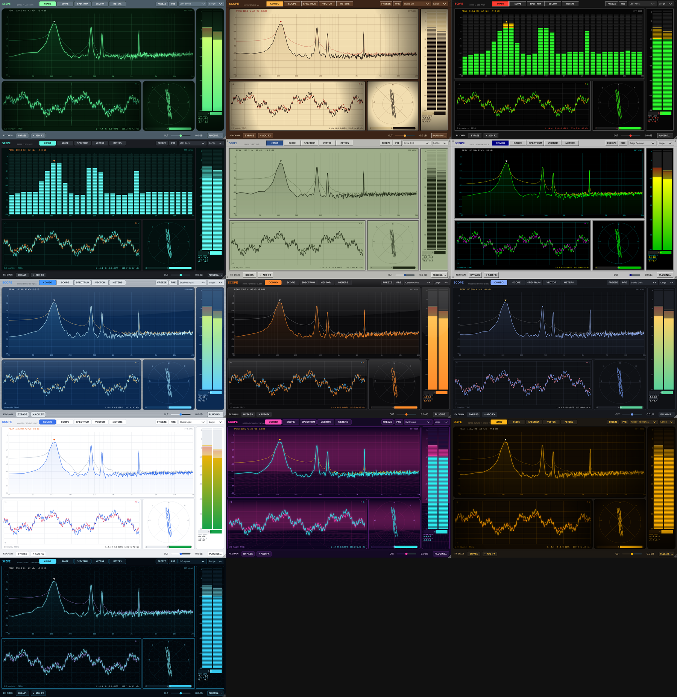

# Scope

An oscilloscope / analyser plugin (VST3, AU on macOS, plus Standalone) that can
also host other plugins in an FX chain. Built with JUCE 8 and CMake.



## Features

- **Five display modes:** Combo, Scope (waveform), Spectrum (FFT), Vector
  (stereo goniometer), Meters (VU needles or bars, LUFS, peak, RMS, correlation).
- **Readouts:** dominant frequency with note name and cents, cursor frequency
  and dB on the spectrum, peak/RMS dBFS, momentary/short-term/max LUFS,
  stereo correlation.
- **13 era-inspired themes:** each one changes rendering, not only colours
  (phosphor glow, CRT vignette, scanlines, bevelled rack panels with screws,
  LED-ladder spectrum, VU needles, LCD pixelation, gloss, synthwave grid,
  hex HUD).
- **Sizes:** Small/Medium/Large/XL presets plus free resize. Mode, theme,
  size and view settings are saved with the DAW session.
- **FX chain hosting:** load VST3 (and AU on macOS) plugins inside Scope.
  Click a slot to open its editor, right-click to bypass, reorder or remove.
  The chain and every plugin's state are saved with the session. PRE switches
  the analyser to the signal before the chain.

Mouse: wheel on the scope changes timebase, right-click the scope or spectrum
for options (trigger, tilt, range, release, peak hold), click the meters to
reset peaks.

## Build

```sh
cmake -B build -DCMAKE_BUILD_TYPE=Release        # fetches JUCE 8.0.4
cmake --build build --config Release
```

Outputs are in `build/Scope_artefacts/Release/` (`VST3/Scope.vst3`, `Standalone/`).
Use `-DJUCE_DIR=/path/to/JUCE` to build against a local JUCE checkout.

Linux needs: `libasound2-dev libx11-dev libxrandr-dev libxinerama-dev
libxcursor-dev libfreetype-dev libfontconfig1-dev libgl1-mesa-dev`.

### Developer tools

`-DSCOPE_BUILD_TOOLS=ON` adds:

- `HostTest`: loads the built `Scope.vst3` like a DAW, puts `TestHalfGain.vst3`
  in Scope's chain through saved state, and checks the output is halved.
- `Snapshots`: renders PNGs of every theme and mode with a test signal
  (`xvfb-run` on a headless Linux box).

## Layout

See [docs/DESIGN.md](docs/DESIGN.md) for the architecture, DSP notes and milestones.

```
Source/PluginProcessor.*      parameters, state, audio path, analysis tap
Source/PluginEditor.*         header, layout, 60 Hz analysis pump
Source/dsp/AnalysisFifo.h     lock-free audio -> UI sample FIFO
Source/dsp/Analyzer.*         FFT, meters, BS.1770 loudness, correlation
Source/hosting/PluginChain.*  serial plugin chain on AudioProcessorGraph
Source/ui/Theme.h             themes + themed LookAndFeel
Source/ui/Views.*             scope, spectrum, vector, meter displays
Source/ui/ChainPanel.*        FX chain strip, plugin windows, scanner
```
